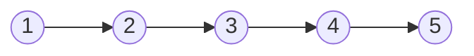
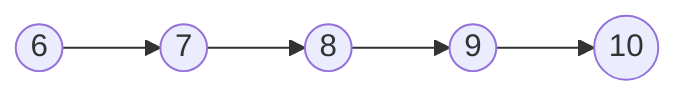

Muy útiles para detectar ciclos en grafos dirigidos y no dirigidos

Similar a los Sets en matemáticas, pero más enfocado a hacerlos útiles para programar

**kuskal algorithm ->** usa disjoint sets, para detectar ciclos en un grafo!!!! 

disjoint Sets: significa que no hay nada en común entre dos sets:

$$\begin{aligned} 
S_{1} &= \{1,2,3,4,5\} \\
S_{2} &= \{6,7,8,9,10\}
\end{aligned} $$

$$
\begin{align}
S_{1} \cap S_{2} = \varnothing 
\end{align}
$$

**Find Operation**
Para encontrar cualquier elemento y a que set pertenece.

**Union Operation**

para unir dos sets, ex: (4,8)
![[disjointSets.png]]

$$S_{1} \cup S_{2} = \{1,2,3,4,5,6,7,8,9,10\}$$

Si existe un edge (u,v), donde u perteneces a un set y v a otro, entonces estoy uniendo dos sets disjuntos.

Agrego otro union (1,5):

![[Pasted image 20260924183946.png]]

ahora tanto 1 y 5 pertenecesn al $S_{3}$

----

**Finding a cycle**
![[Pasted image 20260924184207.png]]

voy a separar el grafo por edges

$$ \begin{align}
  & edge \, 1 : (1,2) \\
  & \text{Creo mi conjunto} \quad S_{1}=\{1,2\}  \\
   \\
  
  & edge \, 2 : (3,4)  \\
   & \text{Creo mi conjunto} \quad S_{2}=\{3,4\}  \\
   \\  \\
   & edge \, 3 : (5,6)  \\
   & \text{Creo mi conjunto} \quad S_{3}=\{5,6\}  \\
   \\ \\ \\
   & edge \, 4 : (7,8)  \\
   & \text{Creo mi conjunto} \quad S_{4}=\{7,8\}  \\
   \\ \\ \\
  &\text{edge \, 5 : (2, 4) , que pertenecen set 1  y 2, creo una union entre esos sets} \\
   \\
  & \text{Creo mi conjunto} \quad S_{5}= S_{1} \cup S_{2} =\{1,2,3,4\}  \\
   \\
  & \text{edge \, 6 : (2,5), 2 pertenece a conjunto 5 y 5 al conjunto 3 } \\ \\
  & \text{Creo mi conjunto} \quad S_{6}= S_{5} \cup S_{3} =\{1,2,3,4,5,6\}  \\ \\ \\
  &\text{edge \, 7 : (1,3) , S6 contiene a 1 y tambien a 3 \textbf{esto es un cycle}} \\ \\
  & \text{edge \, 8 : (6,8), 6 pertenece a conjunto 6 y 5 al conjunto 4 } \\ \\
  & \text{Creo mi conjunto} \quad S_{7}= S_{6} \cup S_{4} =\{1,2,3,4,5,6,7,8\}  \\ \\  \\
  & \text{edge \, 9 : (5,7) , S7 contiene a 5 y tambien a 7 \textbf{esto es un cycle}} \\ \\
\end{align}$$
En programación, no implementamos las operaciones de union o intersección, se usa un método más sencillo.

# Representación con nodos

**Creo nodos con los conjuntos base**

![[Pasted image 20260924192124.png]]

**Creo los sets correspondientes**
![[Pasted image 20260924192320.png]]

# Representación Usando Array

![[Pasted image 20260924192558.png]]

-1 significa que el parent de ese nodo es el mismo nodo, y tambien representa cuanto tardamos en encontrar el nodo. 
Con eso podemos ir construyendo el array, buscando los parents de cada nodo a medida que vamos explorando los edges

![[Pasted image 20260924192826.png]]
![[Pasted image 20260924192936.png]]

-2, las casillas con números negativos representan el número de nodos que notiene, -2 a sí mismo y a otro número

Si tienen el mismo parent el edge, forman un cycle.
![[Pasted image 20260924193424.png]]